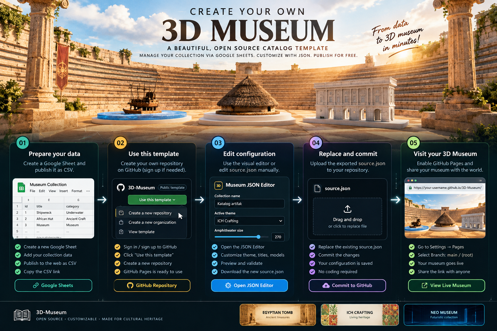

# 3D Museum

**Create your own interactive 3D catalogue for free.** 3D Museum is an open-source template for museums, schools, community groups, living heritage projects, craft collections, and personal catalogues. Manage collection data through Google Sheets, customize the appearance with a visual JSON editor, and publish the site using GitHub Pages.

**No application server. No database. No paid hosting required for the static setup.**

  
  &nbsp;
  

<strong>Having trouble editing JSON?</strong> Use the visual editor instead. Fill in the fields, validate the configuration, export <code>source.json</code>, and replace the file in your own repository. The editor does not publish changes automatically and never needs a GitHub token.

---

## 1. Preview the opening screen

The opening title and its text can be customized through the theme settings in <code>source.json</code>.

## 2. Choose a visual theme

The template includes three opening-screen styles. Change the selected theme using the JSON editor or by editing <code>theme.active</code> manually.

| Theme | Style |
|---|---|
| <code>egyptian_tomb</code> | Bright papyrus and limestone, antique gold, and lapis-blue accents for archaeology and ancient artefacts. |
| <code>ich_crafting</code> | Cream paper, woven motifs, botanical green, and terracotta for living heritage and traditional crafts. |
| <code>neo_museum</code> | Dark cyberpunk styling, digital grid, and neon cyan. |

## 3. Prepare your collection in Google Sheets

Create a Google Sheet and keep the column headers in the first row. The core fields are:

| Column | Required? | Example |
|---|---|---|
| <code>id</code> | Recommended | <code>001</code> |
| <code>title</code> | Yes | <code>Traditional Fishing Boat</code> |
| <code>description</code> | Optional | A short description of the object |
| <code>category</code> | Yes | <code>museum</code>, <code>underwater</code>, or <code>ancient_craft</code> |
| <code>image_url</code> | Optional | One public image URL (older sheets still work) |
| <code>image_urls</code> | Optional | Multiple image URLs separated by <code> \| </code> |
| <code>image_url_1</code>, <code>image_url_2</code>, ... | Optional | One image URL per column |
| <code>year</code> | Optional | <code>1950</code> |

Aliases such as <code>nama</code>, <code>judul</code>, <code>kategori</code>, <code>gambar</code>, <code>deskripsi</code>, and <code>tahun</code> are also supported.

### Try the rich-content sample dataset

Want to test the image carousel and long HTML descriptions before changing your own collection? Download the [sample collection CSV](sample-collection-rich-demo.csv) with 18 example artefacts.

Every example row has **three image links** and a long description containing paragraphs, bold labels, a table, a list, and a reference link. This is designed to demonstrate the new catalogue features.

> **Sample data notice:** these are demonstration descriptions, not verified archaeological records. The extra/detail images are placeholders; the file includes a few existing example image links from the supplied data. Replace placeholders and verify historical claims, image credits, and licences before publishing a real collection.

#### Import the CSV into Google Sheets

1. Download [sample-collection-rich-demo.csv](sample-collection-rich-demo.csv) to your computer.
2. Open [Google Sheets](https://sheets.google.com/) and create a blank spreadsheet.
3. In the spreadsheet, choose **File → Import → Upload**, then select the CSV file.
4. Choose **Replace spreadsheet** for a new test sheet, or **Insert new sheet(s)** if you want to keep your existing tabs. Confirm the import.
5. Open **File → Share → Publish to web**. Select the sheet/tab you just imported and choose **Comma-separated values (.csv)**, then click **Publish**.
6. Copy the published CSV URL and put it into the editor's **Published Google Sheets CSV URL** field. Export `source.json` and replace the file in your own repository.

Google Sheets stores the HTML as text in the `description` cell; the museum renders the allowed formatting when visitors open an artefact.

### Add more than one image

The easiest option is an <code>image_urls</code> column. Paste public image links in one cell and separate them with a vertical bar (<code>|</code>), like this:

<pre><code>https://example.org/photo-front.jpg | https://example.org/photo-side.jpg | https://example.org/photo-detail.jpg</code></pre>

You can keep using <code>image_url</code> for one image, or create separate columns named <code>image_url_1</code>, <code>image_url_2</code>, and <code>image_url_3</code>. The artefact window shows the available pictures as a carousel. Use the arrow buttons to browse and **View full screen** to enlarge a picture. Use image URLs that visitors can open without logging in.

### Format descriptions with bold text, tables, and links

The <code>description</code> cell accepts plain text or a small, safe set of HTML tags. For example, copy this as text into a spreadsheet cell, then replace the sample words and link:

<pre><code>&lt;p&gt;&lt;strong&gt;Origin:&lt;/strong&gt; Wae Rebo, Flores.&lt;/p&gt;
&lt;p&gt;This traditional house represents local knowledge.
&lt;a href="https://example.org/heritage"&gt;Read more&lt;/a&gt;&lt;/p&gt;
&lt;table&gt;
  &lt;tr&gt;&lt;th&gt;Feature&lt;/th&gt;&lt;th&gt;Meaning&lt;/th&gt;&lt;/tr&gt;
  &lt;tr&gt;&lt;td&gt;Roof&lt;/td&gt;&lt;td&gt;Community identity&lt;/td&gt;&lt;/tr&gt;
&lt;/table&gt;</code></pre>

Supported formatting includes paragraphs, **bold**, *italic*, headings, lists, blockquotes, simple tables, inline code, and links. Links open in a new tab. The site rebuilds descriptions from an allowlist of tags and safe link addresses. Script tags, event handlers, embedded frames, and unsafe link schemes are discarded rather than executed.

### Publish the sheet as CSV

1. Open your Google Sheet.
2. Select **File → Share → Publish to web**.
3. Select the correct sheet/tab, then choose **Comma-separated values (.csv)**.
4. Click **Publish** and copy the published URL.
5. Paste the URL into the JSON editor or into the <code>sheetUrl</code> value in <code>source.json</code>.

> **Privacy warning:** data published to the web may be readable by visitors. Do not publish passwords, API keys, confidential records, or private personal information.

---

## 4. Create your own copy using “Use this template”

You need a GitHub account. If you do not have one, [sign up for free at GitHub](https://github.com/signup).

1. Open the [3D-Museum repository](https://github.com/AnggaConni/3D-Museum).
2. Click the green **Use this template** button near the top-right of the repository page.
3. Select **Create a new repository**.
4. Choose your account or organization as the owner and give the new repository a name, for example <code>my-community-museum</code>.
5. Choose the repository visibility, then click **Create repository**.
6. GitHub creates a separate repository from the template. It is not a fork and does not automatically receive future changes from the original template.

## 5. Enable free hosting with GitHub Pages

Once your new repository has been created:

1. Open your new repository on GitHub.
2. Select **Settings** in the repository navigation.
3. In the left sidebar, click **Pages**.
4. Under **Build and deployment**, set **Source** to **Deploy from a branch**.
5. Under **Branch**, choose <code>main</code> and folder <code>/(root)</code>.
6. Click **Save**.
7. Wait for GitHub Pages to publish the website. Return to **Settings → Pages** and open the live URL shown there.

The project will usually be published at:

<code>https://YOUR-USERNAME.github.io/YOUR-REPOSITORY/</code>

No separate web server or database is required for this static hosting method. Buying a custom domain is optional.

---

## 6. Configure the museum with the visual editor

**[Open the 3D Museum JSON Editor](https://anggaconni.github.io/3D-Museum/editor.html)**

After enabling Pages on your own copied repository, open the editor hosted **on your own site**:

<code>https://YOUR-USERNAME.github.io/YOUR-REPOSITORY/editor.html</code>

This lets the editor load that site's own <code>source.json</code>. You can also use the official editor above and select **Import JSON** to load the <code>source.json</code> downloaded from your own repository.

1. Click **Load site config** to read the current configuration, or **Import JSON** to load a file from your computer.
2. Set the collection name and published Google Sheets CSV URL.
3. Choose the title theme and edit its title, subtitle, and footer text.
4. Change the category model paths, enabled/disabled state, target size, or environment settings.
5. Review the generated JSON and validation notes.
6. Click **Download source.json** or **Copy JSON**.
7. Open <code>source.json</code> in your own GitHub repository and click the pencil **Edit** button.
8. Replace the file contents with the exported JSON, then click **Commit changes**.
9. Wait for GitHub Pages to redeploy and refresh your museum.

The editor runs locally in your browser. It has no backend, database, sign-in, telemetry, or GitHub token. It only generates configuration; you remain in control of what gets committed.

## 7. Or edit <code>source.json</code> manually

For normal customization, you do not need to edit <code>index.html</code>. The main settings are centralized in <code>source.json</code>.

### Themes

Set <code>theme.active</code> to one of these values:

- <code>egyptian_tomb</code>
- <code>ich_crafting</code>
- <code>neo_museum</code>

The <code>theme.presets</code> object stores the text and style for each theme. The visual editor changes the selected preset for you.

### Category models

Each object in <code>models</code> supports <code>id</code>, <code>category</code>, <code>enabled</code>, <code>url</code>, and <code>targetSize</code>.

- Set <code>enabled</code> to <code>false</code> to disable a model without deleting its entry.
- Use repository-relative paths, such as <code>./models/shipwreck.glb</code>.
- For filenames containing spaces, URL-encode them, for example <code>./models/african%20hut.glb</code>.
- The current scene supports three category slots: <code>underwater</code>, <code>ancient_craft</code>, and <code>museum</code>. Adding a new model configuration alone does not create another visible category; that requires a corresponding scene slot in <code>index.html</code>.

### 3D environment

The environment is configured separately:

<pre><code>{
  "environment": {
    "enabled": true,
    "url": "./amphitheater/amphitheatre.glb",
    "targetWidth": 270,
    "rotationY": 0,
    "position": [0, 0, 0]
  }
}</code></pre>

- <code>targetWidth</code> sets the horizontal footprint while preserving model proportions.
- <code>rotationY</code> rotates the environment around its vertical axis in degrees.
- <code>position</code> sets an optional <code>[x, y, z]</code> offset.
- Set <code>enabled</code> to <code>false</code> to hide the environment.

---

## How it works

- <code>index.html</code> loads <code>source.json</code> at startup.
- Google Sheets Publish to web provides catalogue rows as CSV.
- PapaParse handles CSV parsing, with a small built-in parser as a fallback if the PapaParse CDN is unavailable.
- The data loader checks required headers and expected categories, tries the published CSV directly, then attempts public proxy fallbacks with timeouts.
- Three.js and GLTFLoader render the 3D models. GSAP powers animations, and OrbitControls provides camera interaction.
- Catalogue images support a carousel and a dedicated full-screen viewer. Descriptions support a safe HTML subset for bold text, links, lists, and tables.
- GitHub Pages serves the static files.

## Technologies and dependencies

- **Three.js / GLTFLoader:** 3D rendering and GLB loading.
- **OrbitControls:** camera interaction.
- **GSAP:** animation.
- **PapaParse:** CSV parsing.
- **Tailwind CSS CDN:** interface styling utilities.
- **Google Fonts:** typography.
- **Google Sheets Publish to web:** collection data source.
- **AllOrigins and Codetabs:** optional public proxy fallbacks. These third-party services may be unavailable or rate-limited.

An internet connection is needed for the hosted data, public CDNs, and proxy fallbacks.

## Troubleshooting

- **GitHub Pages is disabled:** open **Settings → Pages**, select **Deploy from a branch**, choose <code>main</code> and <code>/(root)</code>, then click **Save**.
- **The site is not live yet:** wait for the Pages deployment to finish, then refresh the Pages settings and use the published URL shown there.
- **Editor did not load the expected configuration:** use the editor hosted on your own Pages URL or click **Import JSON** and select your own <code>source.json</code>.
- **Stuck on Connecting:** check the browser DevTools Console. Public proxy services can fail or be rate-limited.
- **No live records:** make sure the sheet is published as CSV and contains a title/name column and a category column.
- **A model does not load:** verify the filename, path, capitalization, and file location in the repository.
- **A custom model/category does not appear:** the current map has only the three category scene slots documented above.
- **An image is missing:** verify the image URL and public accessibility.

## Optional: custom domain

GitHub Pages' free <code>github.io</code> URL is enough to start. You can connect a custom domain later if needed. See [GitHub's custom-domain documentation](https://docs.github.com/en/pages/configuring-a-custom-domain-for-your-github-pages-site) or this [Porkbun + GitHub Pages tutorial](https://horizon-scanning.org/blog/article/the-ultimate-zero-cost-web-architecture-connecting-a-porkbun-domain-to-github-pages.html).

## License and asset rights

The **application source code** is licensed under the [GNU General Public License v3.0 only (GPL-3.0-only)](LICENSE). Use, modify, and redistribute the covered code under the terms of GPLv3.

Third-party 3D models, images, icons, fonts, and other content may have separate licenses and attribution requirements. Verify those rights independently; the software license does not grant rights to assets the project does not own.

---

Built by Angga Conni Saputra · Contributions and improvements are welcome.
