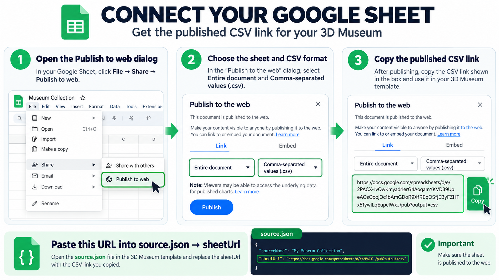

# 3D Museum

A browser-based 3D exhibition that reads collection metadata from a Google Sheets CSV published to the web. Built with Three.js and designed to be adapted by museums, schools, community groups, and heritage projects.

**The Google Sheets URL is configured in `source.json`**, so users can change their data source without editing application code.

## Visual setup guide

Follow the illustrated guide below to publish your Google Sheet as a CSV and connect it to the museum. The full image is available as [HOWTO.png](HOWTO.png).




## Quick setup / Cara menggunakan

1. **Fork or copy this repository** and publish it using GitHub Pages (or another static web host).
2. Create a Google Sheet with column headers in the first row:

   | Column | Required? | Example |
   |---|---|---|
   | `id` | Recommended | `001` |
   | `title` | Yes | `Traditional Fishing Boat` |
   | `description` | Optional | `A traditional wooden boat...` |
   | `category` | Yes | `museum`, `underwater`, or `ancient_craft` |
   | `image_url` | Optional | Public image URL or Google Drive share URL |
   | `year` | Optional | `1950` |

   Aliases such as `nama`, `judul`, `kategori`, `gambar`, `deskripsi`, and `tahun` are also supported.
3. In Google Sheets, choose **File → Share → Publish to web**. Select the relevant sheet/tab and **Comma-separated values (.csv)**, publish it, then copy the published CSV URL. Merely sharing a sheet with “Anyone with the link” is not the same as publishing it to the web.
4. Open `source.json` and replace the `sheetUrl` placeholder with the full URL from Google. **You do not need to edit `index.html`.**
5. Commit the change and open the published website. The app reads `source.json` at startup.

Example `source.json`:

```json
{
  "_instructions": "Copy your Google Sheets Publish to web CSV URL into sheetUrl. Keep this file beside index.html.",
  "sourceName": "My Museum Collection",
  "sheetUrl": "https://docs.google.com/spreadsheets/d/e/YOUR_PUBLISHED_ID/pub?output=csv"
}
```

Keep Google's exact published URL, including `output=csv` when provided.

## How it works

- `index.html` loads `source.json` at startup.
- `source.json` contains the published CSV URL and collection display name.
- PapaParse maps the sheet's rows into records rendered in the 3D scene.
- The sheet must be published for browser-based access. **Do not publish passwords, private data, API keys, or confidential records**; published output may be readable by visitors.
- Google publishing settings, browser CORS restrictions, network connectivity, and third-party service availability may affect loading.

## Want your own domain?

You can keep using the free `https://YOUR-USERNAME.github.io/3D-Museum/` address. **Buying a personal domain is optional**—it is useful if you want a shorter, branded address such as `museum.example.com`.

### Quick guide: Porkbun domain + GitHub Pages

1. **Publish the website on GitHub Pages first.** Put the project files in your repository's root folder, including `index.html`, `source.json`, `favicon.svg`, and `HOWTO.png`. Open **Settings → Pages**, choose **Deploy from a branch**, select the `main` branch and `/(root)`, then save. Wait until GitHub provides your Pages URL.
2. **Buy a domain (optional).** Visit [Porkbun](https://porkbun.com/), search for a domain name, choose an available one, and complete checkout. You need the domain registration; you do not need to buy a separate hosting package for this static site because GitHub Pages serves the website.
3. **Add your custom domain in GitHub first.** In the repository, open **Settings → Pages**. Under **Custom domain**, enter the domain you plan to use, such as `www.example.com` or `example.com`, and click **Save**.
4. **Configure DNS at Porkbun.** Open the domain's DNS management and add the appropriate records. For a `www` subdomain, add a `CNAME` record with host `www` pointing to `YOUR-USERNAME.github.io` (do not include the repository path). For a root/apex domain such as `example.com`, add the four GitHub Pages `A` records below with host `@`:

   ```text
   185.199.108.153
   185.199.109.153
   185.199.110.153
   185.199.111.153
   ```

   Remove conflicting default records for the same host if present. DNS changes can take up to 24 hours to propagate. GitHub's official guide covers the current record types and optional IPv6 records: [Managing a custom domain for GitHub Pages](https://docs.github.com/en/pages/configuring-a-custom-domain-for-your-github-pages-site/managing-a-custom-domain-for-your-github-pages-site).
5. **Check HTTPS.** Return to **Settings → Pages** after DNS has propagated. Once GitHub finishes checking the domain, enable **Enforce HTTPS** when the option becomes available.

For a detailed, illustrated walkthrough, see Angga's article: [The Ultimate Zero-Cost Web Architecture: Connecting a Porkbun Domain to GitHub Pages](https://horizon-scanning.org/blog/article/the-ultimate-zero-cost-web-architecture-connecting-a-porkbun-domain-to-github-pages.html).

> **Tip:** You can do all the steps for hosting this museum without buying a domain. Start with the free GitHub Pages address, and connect a custom domain later whenever you want a personal web address.

## Branding, metadata, and favicon

The page includes general SEO and social-sharing metadata: page title and description, Open Graph tags, Twitter/X card tags, theme color, language, and browser referrer policy. When adapting this repository, update the title, description, and author in the `<head>` of `index.html` to match your project.

The custom `favicon.svg` is linked from `index.html`. Replace it with your own icon if you rebrand the museum. For social preview images, add an absolute, publicly accessible image URL using `og:image` and `twitter:image`; avoid hard-coding a canonical URL until you know the final website address.

## Technologies and free tiers

- **Google Sheets Publish to web (CSV):** simple data source under Google's standard service limits.
- **Three.js:** 3D scene and rendering.
- **OrbitControls:** camera interaction.
- **GSAP:** animation.
- **Tailwind CSS CDN:** interface styling.
- **PapaParse:** CSV parsing.
- **Google Fonts:** typography.
- **AllOrigins (fallback):** public third-party proxy attempted if direct browser fetch fails. It is not guaranteed; remove this fallback if you do not want the dependency.

Third-party libraries are loaded from public CDNs, so an internet connection is needed.

## Troubleshooting

- **Configuration error:** validate `source.json` JSON syntax and check that `sheetUrl` contains the full published CSV URL.
- **No live data:** publish the correct sheet/tab as CSV, and ensure categories match `underwater`, `ancient_craft`, or `museum`.
- **Browser fetch failure:** open the published CSV URL directly to confirm it is accessible. The proxy fallback may help with CORS but is not guaranteed.
- **Images not shown:** verify the image URL is public. Google Drive images may need public viewing permissions.

## License and reuse

See [LICENSE](LICENSE). Retain attribution and check the license before redistribution or commercial use.

Built by Angga Conni Saputra.
